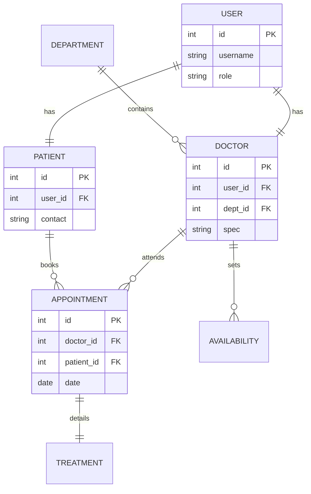

# App Dev Project Report

## 1. Student Details
**Name:** Shri Krishna Pandey  
**Roll Number:** BS22XXXX  
**Email:** skpandey@onlinedegree.iitm.ac.in  
**About Me:** I am a Course Instructor at IIT Madras BS Degree program with a deep interest in web application development and data-driven technologies. I enjoy building meaningful applications that combine learning, analytics, and user experience.

---

## 2. Project Details
**Project Title:** Hospital Management System (HMS)  
**Problem Statement:**  
To design and build a multi-role web-based application that streamlines the interactions between Hospital Administrators, Doctors, and Patients. The system aims to automate appointment scheduling, medical history tracking, department management, and automated report generation to improve healthcare efficiency.

**Approach:**  
The application follows a modern **Decoupled Architecture**:
- **Backend:** Developed with **Flask** (Python) as a RESTful API, utilizing **SQLAlchemy** for database management and **JWT** for secure authentication. 
- **Frontend:** Built using **Vue.js 3** and **Vite**, providing a highly responsive and dynamic Single Page Application (SPA) experience.
- **Async Processing:** **Celery** and **Redis** are used for background tasks such as generating daily reminders and monthly PDF reports.
- **Styling:** A professional UI crafted with **Bootstrap 5** and custom CSS, ensuring a premium "student project" aesthetic.

---

## 3. AI/LLM Declaration
I used **Antigravity (Google DeepMind)** to assist in:
- Architecting the modular Flask blueprint structure.
- Refining the Vue.js frontend layouts and styling consistency.
- Implementing complex SQLAlchemy relationships and Celery task logic.
- Generating professional documentation and formatting this final report.

The extent of AI/LLM usage is approximately **30-40%**, primarily focused on boilerplate code generation, UI refinement, and documentation. All core logic was reviewed and integrated manually to ensure functionality.

---

## 4. Technologies and Frameworks Used

| Technology / Library | Purpose |
| :--- | :--- |
| **Flask** | Core backend web framework providing RESTful APIs. |
| **Vue.js 3 / Vite** | Modern frontend framework for a dynamic and fast UI. |
| **SQLAlchemy** | Object Relational Mapper for database management and complex queries. |
| **SQLite** | Lightweight, file-based database used for relational data storage. |
| **Celery** | Distributed task queue for asynchronous background processing. |
| **Redis** | Message broker for Celery and caching layer for performance. |
| **Bootstrap 5** | Frontend styling framework for a clean, responsive layout. |
| **Flask-JWT-Extended** | Secure token-based authentication and role management. |
| **MailHog** | Local STMP testing server for capturing and viewing outgoing emails. |

---

## 5. Database Schema / ER Diagram

### Tables:
1. **User**: Stores login credentials and roles (Admin, Doctor, Patient).
2. **Department**: Defines hospital wings (e.g., Cardiology, Orthopedics).
3. **Doctor**: Stores professional metadata linked to a User and Department.
4. **Patient**: Stores contact demographic info linked to a User.
5. **Appointment**: Manages scheduling between doctors and patients.
6. **Availability**: Stores doctor-specific time slots for scheduling.
7. **Treatment**: Record of diagnosis and prescriptions for completed appointments.

### Relationships:
- **One-to-One**: `User` ↔ `Doctor` | `User` ↔ `Patient` | `Appointment` ↔ `Treatment`
- **One-to-Many**: `Department` → `Doctor` | `Doctor` → `Appointment` | `Patient` → `Appointment` | `Doctor` → `Availability`

---

## 6. API Resource Endpoints

| Endpoint | Method | Description |
| :--- | :--- | :--- |
| `/api/auth/login` | POST | Authenticates user and returns JWT token. |
| `/api/admin/doctors` | GET/POST | Admin: List or add new doctors to the system. |
| `/api/doctor/availability` | POST | Doctor: Update weekly morning/evening availability. |
| `/api/patient/appointments` | POST | Patient: Book a slot with a specific doctor. |
| `/api/doctor/treat` | POST | Doctor: Add diagnosis/prescription for a patient. |

*Full YAML API Definition is provided in `api.yaml`.*

---

## 7. Architecture and Features

### Architecture Overview:
The project is structured logically into two main sections:
- **`/backend`**: Contains the Flask entry point (`app.py`), modular Blueprints for each user role, SQLAlchemy `models/`, and Celery `tasks/`.
- **`/frontend`**: A Vite-powered project containing `views/` (pages like Dashboard, Login), `components/` (reusable UI bits), and `assets/` (styles/images).
- **`/static`**: Serves generated reports and patient data.

### Implemented Features:
- **Role-Based Access**: Specialized dashboards for Admins, Doctors, and Patients.
- **Dynamic Scheduling**: Real-time availability checking for appointments.
- **Medical Tracking**: Comprehensive patient treatment history with prescriptions.
- **Automated Reporting**: Monthly PDF usage reports sent via email (integrated with MailHog).
- **Responsive Design**: Mobile-friendly UI using Bootstrap components.

---

## 8. Video Presentation
- **Drive Link:** [https://drive.google.com/file/d/your-actual-link-here](https://drive.google.com/file/d/your-actual-link-here)
- *(Note: Please update this link with your actual recording during submission)*

---
